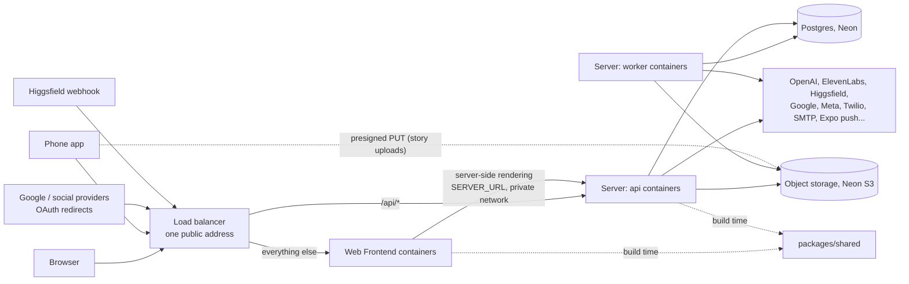

# Architecture

Last written: 2026-11-16, from the code on branch `server-web-split` and the approved design
`docs/superpowers/specs/2026-11-16-server-web-split-design.md`.

This document describes what is built. The product is three apps and one shared package: the **Server** (`apps/server`,
every API route, the database, the job worker), the **Web Frontend** (`apps/web`, pages only) and the **Mobile App**
(`apps/mobile`). Where the code differs from the design or from another doc, §7 says so.

Paths such as `server/api/brand-route.ts` or `worker/main.ts` are inside `apps/server` unless a section says otherwise.
`apps/brandpilot-ai` (a Reddit Devvit app) is unrelated to this product and is left out.

---

## 1. Overview

### 1.1 The apps

| Folder | Name | Owns | Deploys as |
|---|---|---|---|
| `apps/server` | `server`, "Server" | 113 API route files (`app/api/**/route.ts`: `/api/v1/*` and `/api/auth/*`), `server/` (agents, AI, jobs, Prisma access, rendering, integrations; the folder keeps its name inside the app), `worker/main.ts`, `prisma/`, `auth.ts`, `auth.config.ts`, `middleware.ts`, `instrumentation.ts`, `scripts/`, `tests/` (vitest), `assets/` (fonts) | Docker image from `apps/server/Dockerfile` (Next.js `output: "standalone"`; carries the Prisma engine, ffmpeg/ffprobe and fonts). One Dockerfile, three targets: **api** (`node server.js`, port 3101), **worker** (`node dist/worker.js`, no port) and **migrate** (`prisma migrate deploy`, then exits). Port 3101 in dev. |
| `apps/web` | `web-frontend`, "Web Frontend" | 31 pages (`app/**/page.tsx`), `components/`, `lib/` (including `server-fetch.ts`), `public/`, `middleware.ts`, `app/healthz/route.ts`, `e2e/` (Playwright), website-only unit tests. No database, no Prisma, no Auth.js server code, no secrets. | Docker image from `apps/web/Dockerfile` (`output: "standalone"`, `node server.js`, port 3100). Port 3100 in dev; rewrites `/api/:path*` to the Server. |
| `apps/mobile` | `mobile-app` | Expo (React Native) app. Calls the API over HTTP with a Bearer token (`src/api/client.ts`, `src/api/endpoints.ts`). Deep-link scheme `espanda`. Its default API address is `http://localhost:3101`. | Store builds. |
| `packages/shared` | `@espanda/shared` | Pure TypeScript with no dependencies, imported by Server and Web Frontend (`transpilePackages` in both `next.config.ts`): `website.ts` (`normalizeWebsite`, `safeHttpUrl`, `domainOf`...), shell cookie names and max age, `BY_HAND_STEPS`, `CAPTION_LIMITS`, `zoneCity`/`offerPercents`, product-name helpers, `PERMISSIONS` and `PermissionKey`, and the response types of the new endpoints (`api/shell.ts`, `api/admin.ts`, which also holds the admin paging constants and `period()`). | Not deployed; imported at build time. |
| `deploy/`, `docker-compose.yml` | | `deploy/nginx.conf` and the compose stack (`migrate`, `worker`, `server-api`, `web`, `nginx`) for a single box. `docs/DEPLOY_EC2.md` covers the scaled setup. | |

Root npm workspaces are `apps/*` and `packages/*`. Root scripts: `dev:server`, `dev:web`, `build:server`, `build:web`,
`lint` (server, web, shared), `test` (server, web), `typecheck` (server, web, mobile), `test:e2e`, `db:*`, and
`check:web-bundle` (`scripts/check-web-bundle.mjs`: after a website build, fails if `apps/web/.next` contains
`PrismaClient` or the name of a Server secret).

### 1.2 Who talks to whom

Production, with a load balancer (nginx in the compose stack, an ALB on EC2):



Development:

```
browser ──▶ apps/web :3100 ── pages
              └─ /api/*  rewritten (next.config.ts) to SERVER_URL, default http://localhost:3101
phone ─────▶ apps/server :3101 directly (EXPO_PUBLIC_API_URL default)
npm run worker:dev -w server ──▶ worker/main.ts (the job loop)
```

The browser sees one origin, so the Auth.js session cookie, the shell cookies (`bp_active_workspace_id`,
`bp_active_brand_id`) and OAuth callbacks keep working with no CORS. `AUTH_URL` is the **website's** public URL
(`http://localhost:3100` in dev), on the Server as well.

### 1.3 Things that hold across the apps (checked in code)

- **Tenancy:** User → Workspace → Brand (called "project" or "business" in the UI). Brand routes live under
  `/api/v1/workspaces/[workspaceId]/brands/[brandId]/*`.
- **Route guard:** brand routes call `authorizeBrandRoute` (`server/api/brand-route.ts`): signed-in user → the optional
  `X-Workspace-Id` header must match the path (`assertWorkspaceHeaderMatchesPath`) → `requireBrandAccess` →
  `requirePermission(workspaceId, userId, permission, brandId)`. Workspace routes use `workspaceHandler`
  (`server/api/workspace-route.ts`) with the same order minus brand access. Errors are `application/problem+json`.
- **Who is calling:** `requestUserId` (`server/auth/request-user.ts`): an `Authorization: Bearer` header is checked as a
  mobile token first; otherwise the Auth.js session cookie. So almost every v1 route accepts both.
- **Sessions:** Auth.js v5, stateless JWT in an encrypted cookie, 7 days rolling (`auth.config.ts`). Revocation through
  `User.sessionVersion`. Mobile tokens are the same JWE with a different salt (`mobile-session`), 30 days; a disabled
  account or a bumped `sessionVersion` kills both.
- **Platform admin:** `User.isPlatformAdmin`, set in the database. API: `platformAdmin()` → 401/403; the admin routes
  turn the 403 into a 404 (`adminOnly`, `server/api/admin-route.ts`). Pages: the admin layout calls `notFound()` unless
  `/api/v1/me/shell` says `isPlatformAdmin`.
- **Client IP:** `clientIp` (`server/auth/rate-limit.ts`) takes the right-most `x-forwarded-for` entry (the one the
  trusted load balancer added), falling back to `x-real-ip`. nginx overwrites the header with the client address.
- **Provider credentials** are stored encrypted (`server/crypto/credentials.ts`, `CREDENTIALS_ENCRYPTION_KEY`, versioned
  keys). Tokens never go to the browser or phone; routes return connection status only.
- **Jobs** live in Postgres. Claiming is lease-based (`server/jobs/claim.ts`), so several runners are safe.
- **Media** lives in a private S3-compatible bucket (Neon Object Storage, `server/storage/media.ts`, configured by the
  `STORAGE_*` variables). Clients get signed links that last about an hour.

---

## 2. Every path a request or link takes

Each path lists: who starts it, which app serves it, how it is authenticated, and what env var or external
registration it depends on.

### 2.1 Browser → website page

- **Starts:** browser navigation.
- **Served by:** a Web Frontend page (server component).
- **Auth, in the website's `middleware.ts`:** public pages are `/login`, `/invite/*`, `/forgot-password`,
  `/reset-password`. Every other page needs an Auth.js session **cookie** (`authjs.session-token`,
  `__Secure-authjs.session-token`, or either name with the `.0` chunk suffix); without one the middleware redirects to
  `/login?next=<path and query>`. It checks existence only. It also sets an `x-pathname` request header. The matcher skips
  `api/`, `healthz`, `_next/static`, `_next/image`, `favicon.ico`, `icon.png` and `brand/*`. The real check is the Server's:
  a stale or revoked cookie gets a 401 from the Server, which `serverFetch` turns into `/login?expired=1&next=…`.
- **Data:** server components call the Server through `serverFetch(path, init)` (`apps/web/lib/server-fetch.ts`):
  - It requests `SERVER_URL` (default `http://localhost:3101`) plus the path, forwards the incoming `cookie` header
    (not `x-forwarded-for`), and sends `cache: "no-store"`.
  - The `api` tagged template URL-encodes every interpolated value, so a route param cannot add a path segment or query.
  - 401 → redirect to `/login?expired=1&next=<x-pathname>` (same-site paths only; `//host` is dropped). 403 and 404 →
    `notFound()`. Any other non-2xx → throws `server <status>`, which reaches the error page.
  - `getShell()` is `serverFetch("/api/v1/me/shell")` wrapped in React `cache`, so the layout and the page share one call
    per request. Most pages read nothing else (§5). The admin pages call `/api/v1/admin/*` (§4).
- **Depends on:** `SERVER_URL` (Web Frontend). No secrets.

### 2.2 Browser → `/api/v1/*` → API

- **Starts:** client components: `fetch` through the `request()` helper in `components/settings/api.ts` and similar;
  `navigator.sendBeacon` for page views (`components/page-view-tracker.tsx`); the AI SDK chat transport. All use relative
  `/api/...` URLs.
- **Served by:** the Server's route handler. In production the load balancer sends `/api/*` to the Server api containers
  (ALB rule, or `location /api/` in `deploy/nginx.conf`) before it reaches the website. In dev the Web Frontend's
  `next.config.ts` rewrite `/api/:path*` → `${SERVER_URL}/api/:path*` does it, with `experimental.proxyTimeout` 330 s
  (the dev proxy otherwise cuts a request after 30 s). The rewrite is compiled into the production website too, from the
  build-time `SERVER_URL`, but production traffic for `/api/*` does not reach it.
- **Auth:** session cookie (same origin). The Server's `middleware.ts` runs on `/api/v1/*` only: it runs Auth.js's
  middleware, which rolls the session cookie forward on every call, and copies the `Set-Cookie` headers onto the response.
  Each route still checks the session itself. A 401 from a settings call sends the browser to login
  (`components/settings/api.ts`).
- **Long requests:** 18 route files export `maxDuration = 300`, 2 export 120, 2 export 60 (see §3). With
  `RUN_JOBS_IN_API=false` (production) queued work no longer runs inside those requests (§2.8). Load balancer idle timeout
  and nginx `proxy_read_timeout`/`proxy_send_timeout` are 330 s; nginx does not buffer `/api/` (streaming: chat, reel
  NDJSON, story zip).
- **Upload size:** image upload (`media`) 4 MB, voice clone 4 MB, voice take 1 MB (multipart); nginx allows 5 MB
  (`client_max_body_size`). Story photos and clips do not pass through the API: the phone PUTs them straight to storage
  with a presigned URL.

### 2.3 `/api/auth/*`: sign-in, sign-out, session, Google callback

- **Served by:** the Server, `app/api/auth/[...nextauth]/route.ts` (`GET`, `POST` = Auth.js handlers), reached at
  `/api/auth/*` through the dev rewrite or the load balancer. The Server's middleware does not run on it (matcher is
  `/api/v1/:path*`).
- **Providers:** Credentials (email + password, `checkPassword` with login rate limits: 5 per email per IP, 50 per email,
  30 per IP, each per 15 min, keyed by the client IP) and Google (only when `GOOGLE_CLIENT_ID` and
  `GOOGLE_CLIENT_SECRET` are set; verified emails only; new users provisioned by `provisionGoogleUser`).
- **Sign-in:** `components/auth/login-form.tsx` (a client form on `next-auth/react`) calls
  `signIn("credentials", { redirect: false })`, which posts to `/api/auth/*`, and `signIn("google", { redirectTo })`,
  which redirects the browser to Google; Google redirects back to `/api/auth/callback/google`. The Google button shows
  when `getProviders()` lists `google`, so the website holds no provider secret. `getSession()` sends someone already
  signed in on to `next`.
- **Sign-out:** `components/workspace/sign-out-item.tsx` calls `next-auth/react` `signOut({ redirectTo: "/login" })`
  → `POST /api/auth/signout`.
- **Session:** `next-auth/react` reads `/api/auth/session`; Server code calls `auth()` (wrapped in `auth.ts` to throw
  `SessionUnverifiedError` when the database can't be reached).
- **Depends on:** `AUTH_SECRET` (Server only), `AUTH_URL` (the website's public URL; in production the api refuses to
  start unless it is `https://`, `instrumentation.ts`), `trustHost: true` (set in `auth.config.ts`; `AUTH_TRUST_HOST` is
  also in `.env.example`). Google: OAuth client registered with redirect URI `<AUTH_URL>/api/auth/callback/google`.

### 2.4 Account emails and the pages they open

- **Starts:** the Server when someone is invited (`POST …/invitations`, `POST …/brands/[brandId]/members`) or asks for a
  password reset (`POST /api/v1/auth/password/forgot`).
- **Built with:** `appUrl()` in `server/auth/tokens.ts`: `AUTH_URL` + `/invite/<token>` or
  `/reset-password?token=<token>`. In production a missing `AUTH_URL` throws. Dev fallback `http://localhost:3100`.
- **Sent by:** the job queue (`EMAIL_SEND_JOB`), so by the worker in production, over SMTP (`SMTP_HOST`, `SMTP_PORT`,
  `SMTP_USER`, `SMTP_PASS`, `SMTP_TIMEOUT`, `EMAIL_FROM`). The worker therefore needs the same `AUTH_URL` and SMTP
  variables as the api. Without `SMTP_HOST` and `EMAIL_FROM`, email is "not configured" and routes say so.
- **Opens:** website pages `/invite/[token]` and `/reset-password`, which then call `GET /api/v1/auth/invitations/[token]`,
  `POST /api/v1/auth/invitations/accept` and `POST /api/v1/auth/password/reset`. Auth: the token itself.

### 2.5 Phone → API

- **Starts:** the Expo app. `API_URL = EXPO_PUBLIC_API_URL ?? "http://localhost:3101"`; every call goes to
  `${API_URL}/api/v1${path}`. In production `EXPO_PUBLIC_API_URL` is the public address: the load balancer sends `/api/*`
  to the Server.
- **Auth:** `Authorization: Bearer <token>`, plus `X-Workspace-Id` on workspace and brand calls. Tokens come from the
  mobile sign-in endpoints, all `POST /api/v1/mobile/*`, no prior auth:
  - email code: `/mobile/email-step` → `/mobile/code` → `/mobile/session`
  - password: `/mobile/password`; new account: `/mobile/register` → `/mobile/register/verify`
  - phone: `/mobile/phone/code` → `/mobile/phone/session` (Twilio Verify: `TWILIO_ACCOUNT_SID`, `TWILIO_AUTH_TOKEN`,
    `TWILIO_VERIFY_SERVICE_SID`)
  - Google: the app gets a Google ID token natively (`EXPO_PUBLIC_GOOGLE_WEB_CLIENT_ID`,
    `EXPO_PUBLIC_GOOGLE_IOS_CLIENT_ID`) and posts it to `/mobile/google`; the Server checks it against Google's keys
    with audience `GOOGLE_CLIENT_ID`.
- **Connectivity check:** the app probes `GET /api/v1/me` (any answer counts as online). The phone does not call
  `/api/v1/me/shell`, `/api/v1/me/context` or `/api/v1/admin/*`.
- **Push:** the app registers its Expo push token at `POST /api/v1/mobile/push-device`; the Server sends through
  `https://exp.host/--/api/v2/push/send` (`EXPO_ACCESS_TOKEN` optional).
- **Dev only:** `apps/server/next.config.ts` adds CORS headers on `/api/v1/*` for the Expo web preview at
  `http://localhost:8090` when `NODE_ENV` is `development`; production sends none.

### 2.6 Social-provider OAuth connect

Providers with OAuth: `meta`, `instagram`, `threads`, `google` (Analytics/Search Console), `google_business`, `reddit`,
`pinterest` (`PROVIDER_SLUGS` in `server/integrations/providers.ts`). Shopify is connected with an Admin API token
instead (`POST …/integrations/shopify`), no OAuth.

1. **Start.** Website or phone calls `POST /api/v1/workspaces/[workspaceId]/brands/[brandId]/connections/start`
   (session or Bearer, `integrations.manage`). Body has `provider`; the phone adds `client: "mobile"`. The Server stores
   an `OAuthStateTransaction` (hashed state, 10 min TTL, `client` web or mobile) and returns the consent URL.
2. **Provider.** The browser (web) or an in-app browser (`expo-web-browser` `openAuthSessionAsync`, phone) goes to the
   provider's consent page.
3. **Callback.** The provider redirects to `<AUTH_URL>/api/v1/integrations/<slug>/callback`, or to
   `<PROVIDER>_REDIRECT_URI` when that env var is set (`META_REDIRECT_URI`, `INSTAGRAM_REDIRECT_URI`,
   `THREADS_REDIRECT_URI`, `GOOGLE_REDIRECT_URI`, `GOOGLE_BUSINESS_REDIRECT_URI`, `REDDIT_REDIRECT_URI`,
   `PINTEREST_REDIRECT_URI`). This exact URL must be registered in each provider's developer console. It stays on the
   website's origin; the load balancer (or the dev rewrite) delivers it to the Server.
4. **Web flow.** The callback needs the browser's session cookie, completes the connect (`completeConnect` re-checks
   brand access and `integrations.manage`), then redirects 303 to `<AUTH_URL>/settings?tab=connections` with
   `connected=` or `connectError=`. Signed out mid-connect → `/login?next=/settings?tab=connections`.
5. **Phone flow.** If the stored state says `client: "mobile"`, the callback does **not** complete the connect (the
   in-app browser has no session). It redirects 303 to `espanda://connect?provider=…&state=…&code=…` (or
   `error=cancelled`). The app then calls `POST /api/v1/integrations/[provider]/complete` with its Bearer token;
   the connect only succeeds for the user who started it.
- **Depends on:** `AUTH_URL`; provider keys `META_APP_ID`/`META_APP_SECRET`, `INSTAGRAM_APP_ID`/`INSTAGRAM_APP_SECRET`,
  `THREADS_APP_ID`/`THREADS_APP_SECRET`, `GOOGLE_CLIENT_ID`/`GOOGLE_CLIENT_SECRET` (shared by sign-in, Google and Google
  Business connects), `REDDIT_CLIENT_ID`/`REDDIT_CLIENT_SECRET`, `PINTEREST_APP_ID`/`PINTEREST_APP_SECRET`;
  the `espanda` scheme in `apps/mobile/app.json`; `CREDENTIALS_ENCRYPTION_KEY` to store tokens. All on the Server.

### 2.7 Incoming webhooks

Only one webhook exists in code:

- `POST /api/v1/webhooks/higgsfield/[renderId]?s=<secret>`. **Starts:** Higgsfield, when a reel clip finishes.
  **Served by:** the Server, through the load balancer's `/api/*` rule. **Auth:** a per-render secret in the query
  string, compared in constant time with `ReelRender.webhookSecret`; rate limited 120/min per IP. The body is never
  trusted: it only queues the render's next poll. Always answers `200 {}`.
- **Registration:** none in a console. The URL is passed with each Higgsfield request (built in `server/reels/render.ts`,
  which runs in the worker), from `AUTH_URL`, and only when `AUTH_URL` starts with `https://` (Higgsfield can't call
  localhost; polling carries the render then).
- Secrets travel in this URL and in OAuth callback URLs, so access logs must not record query strings: `deploy/nginx.conf`
  logs without them; ALB access logs cannot (see `docs/DEPLOY_EC2.md`).

There are no ElevenLabs or Shopify webhook routes. Shopify catalogue sync is pulled by jobs; ElevenLabs calls are
synchronous.

### 2.8 Jobs: queue, worker, daily sweep

Job types (`server/jobs/runner.ts`): agent run, catalogue sync, daily sweep, email send, photoshoot, publish, reel
asset, reel render, story render, voice delete. Jobs wait in Postgres until something runs `runDueJobs`.

- **`kickRunner()`** runs right after a route queues work: `after(() => runDueJobs())`, in the same API process. It
  returns at once when `RUN_JOBS_IN_API === "false"`. **`kickIfDue()`** (on routes the open app polls: agents, agent
  runs, context docs, first ideas, photoshoots, products, reel options, reel detail; at most once per 30 s per instance)
  calls `kickRunner()` when a job is overdue, so it does nothing under the same switch.
- **`RUN_JOBS_IN_API`:** unset in dev, so work starts straight away inside the api process (this is why many routes export
  `maxDuration = 300`). Production sets `false` on the api (`docker-compose.yml` does it for `server-api`): the api only
  enqueues, and the worker runs everything, so renders (ffmpeg, sharp) and publishing stay out of API requests.
- **The worker** (`worker/main.ts`) is a standalone process, not a Next route. Dev: `npm run worker:dev -w server`. Built:
  `npm run build:worker -w server` bundles it with esbuild into `dist/worker.js`, which the image's `worker` target runs.
  Loop: `WORKER_CONCURRENCY` (default 4) independent loops, each calling `runDueJobs({ budgetMs: 30000 })` every
  `WORKER_INTERVAL_MS` (default 15000; a short interval keeps Neon awake, which costs money), so a long agent run
  doesn't hold up an email or a publish. Errors are logged and the loop continues. On SIGTERM or SIGINT it claims no new
  job (the signal reaches `runDueJobs`), finishes the jobs in flight and exits 0 (compose `stop_grace_period: 360s`;
  on EC2 a lifecycle-hook step runs `docker stop -t 360`, see `docs/DEPLOY_EC2.md`). Several workers are safe
  (lease-based claims).
- **Daily sweep:** once the UTC hour is 5 or later and the worker has not swept that UTC day (kept in memory), it calls
  `enqueueDailySweep()`. The sweep job carries a per-day idempotency key, so a restart that forgets the day, or a second
  worker, queues it only once. The sweep (`dailySweep` in `runner.ts`) refreshes expiring tokens, prunes old rows,
  renews due plans, runs monthly plans, queues each brand's catalogue sync, purges old recordings and stale uploads, and
  starts the daily agents for every active brand (skipping agents already started that day).
- **Unknown job types:** a job whose type has no handler in this release is put back to pending without counting an
  attempt, so an older worker leaves a newer release's jobs alone.
- **`/api/v1/jobs/run`** is kept for a manual or external trigger. `GET` enqueues the daily sweep (idempotent per day)
  and drains the queue for up to 120 s; `POST` only drains. Auth: `Authorization: Bearer $CRON_SECRET`, constant-time
  compare; it fails closed when `CRON_SECRET` is unset, which is how production runs. `vercel.json` and the Vercel cron
  are gone.
- **Admin "viewed" audit rows** no longer use `after()` in pages: `POST /api/v1/admin/people/[userId]/visit` and
  `POST /api/v1/admin/workspaces/[workspaceId]/visit` write them (§4).

### 2.9 Outbound calls from the Server (api and worker)

| To | Used for | Env |
|---|---|---|
| Postgres (Neon) via Prisma | Everything | `DATABASE_URL` (pooled), `DATABASE_URL_UNPOOLED` (migrations) |
| Object storage (Neon, S3 API) | Media, story frames, reel clips, voice takes; presigned GET and PUT | `STORAGE_ACCESS_KEY_ID`, `STORAGE_SECRET_ACCESS_KEY`, `STORAGE_ENDPOINT`, `STORAGE_REGION`, `STORAGE_BUCKET` (default `media`). Passed to the S3 client explicitly, so an EC2 instance role's `AWS_*` credentials are never picked up. |
| OpenAI (`api.openai.com`) | Agents, chat (with web search tool), photoshoots, model-name checks | `OPENAI_API_KEY`; models are set in the app (platform admin), not env |
| ElevenLabs (`api.elevenlabs.io`) | Reel voices, voice cloning, voice library | `ELEVENLABS_API_KEY` |
| Higgsfield (`api.higgsfield.ai`) | Reel clips, presenters, previews | `HIGGSFIELD_API_KEY_ID`, `HIGGSFIELD_API_KEY_SECRET` |
| Google | OAuth, Analytics, Business Profile (reviews, posts), Places search, PageSpeed | `GOOGLE_CLIENT_ID`, `GOOGLE_CLIENT_SECRET`, `GOOGLE_MAPS_API_KEY` (falls back to `GOOGLE_PAGESPEED_API_KEY`), `GOOGLE_PAGESPEED_API_KEY` |
| Meta, Instagram, Threads, Pinterest, Reddit | Publishing, inbox, insights, token refresh | Provider app id/secret (see §2.6) |
| Shopify (store admin API) | Catalogue sync | Per-store token, stored encrypted |
| Twilio Verify (`verify.twilio.com`) | Phone sign-in codes | `TWILIO_*` |
| SMTP | Account emails | `SMTP_*`, `EMAIL_FROM` |
| Expo push (`exp.host`) | Phone notifications | `EXPO_ACCESS_TOKEN` (optional) |
| LanguageTool | Optional French grammar pass | `LANGUAGETOOL_URL` |
| `open.er-api.com` | USD→INR rate for spend views | `USD_INR` overrides it |
| Brand and competitor websites | Research, site check, audits (SSRF-guarded `safeFetch`) | none |

### 2.10 Website server-side rendering → Server

Covered by `serverFetch` in §2.1. `SERVER_URL` is the Server's private address: `http://server-api:3101` under compose,
an internal ALB on EC2, `http://localhost:3101` in dev. The Server authorises these calls from the forwarded cookie like
any browser call. Client components keep relative `/api/...` URLs through the public address. `GET /healthz` on the
website answers `ok` without calling the Server, so a Server outage does not take website instances out of rotation.

### 2.11 Shared code and the import boundary

Both apps import `@espanda/shared` at build time. The boundary is enforced by lint and one build check:

- `apps/web/eslint.config.mjs` bans, by name, `@prisma/client`, `prisma`, `next-auth` (except `next-auth/react`),
  `@auth/*`, `@aws-sdk/*`, `@ai-sdk/openai`, `nodemailer`, `bcryptjs`, `sharp`, `ffmpeg-static`, `ffprobe-static`, `jose`,
  and any relative import that leaves `apps/web`.
- `apps/server/eslint.config.mjs` bans `@/components` and any relative import that leaves `apps/server`.
- `npm run check:web-bundle` (after `build:web`) fails if the website's build output carries `PrismaClient` or a Server
  secret's name.
- Server modules that must never reach a bundle import `server-only`.

---

## 3. API route inventory

**98 route files, 128 method handlers, one row per handler below.** All live in `apps/server/app/api/` (they were in
`apps/web/app/api/` before the split and moved unchanged). The 15 handlers the split added are in §4.

How to read the columns:

- **Auth.** *none*: no sign-in needed (a token in the body or path may stand in, noted). *session or Bearer*: web session
  cookie or mobile Bearer token (`requestUserId`). *cron secret*, *webhook signature*, *platform admin*: as named.
- **Permission.** The permission key passed to `authorizeBrandRoute` / `workspaceHandler` / `requirePermission`. "member"
  means `requireWorkspaceMember` only. "—" means none beyond Auth.
- **Called by.** Found by searching `apps/web/components`, `apps/web/app` (client components; server components use
  `serverFetch`) and `apps/mobile/src` for the path and method.
  *website*, *phone*, *both*, *provider*, *cron*, or **nobody** when no caller was found.
- All `/api/v1/*` responses for errors are `application/problem+json`.

### 3.1 Auth.js (2)

| # | Method | Path | Auth | Permission | Purpose | Called by | Notes |
|---|---|---|---|---|---|---|---|
| 1 | GET | `/api/auth/[...nextauth]` | none (Auth.js) | — | Session, CSRF, providers, OAuth callbacks (`/callback/google`) | website, Google | Auth.js `handlers`. The Server's middleware matches `/api/v1/*` only, so it does not run here. |
| 2 | POST | `/api/auth/[...nextauth]` | none (Auth.js CSRF) | — | Sign-in and sign-out | website (sign-in and sign-out via `next-auth/react`) | Credentials sign-in posts here from `LoginForm` (`/api/auth/callback/credentials`). Login rate limits in `checkPassword`. |

### 3.2 Account: invitations and passwords (4)

| # | Method | Path | Auth | Permission | Purpose | Called by | Notes |
|---|---|---|---|---|---|---|---|
| 3 | GET | `/api/v1/auth/invitations/[token]` | none (token in path) | — | Preview an invitation | website (`/invite/[token]`) | |
| 4 | POST | `/api/v1/auth/invitations/accept` | none (token in body) | — | Accept an invitation; sets `bp_active_*` cookies | website | Sets a password for a new user. |
| 5 | POST | `/api/v1/auth/password/forgot` | none | — | Queue a reset email | website (`/forgot-password`) | `maxDuration` 300; always 202 (no account enumeration); `kickRunner`. |
| 6 | POST | `/api/v1/auth/password/reset` | none (reset token in body) | — | Set a new password | website (`/reset-password`) | |

### 3.3 Mobile sign-in and device (11)

| # | Method | Path | Auth | Permission | Purpose | Called by | Notes |
|---|---|---|---|---|---|---|---|
| 7 | POST | `/api/v1/mobile/email-step` | none | — | Next step for an email: password, code or register | phone | |
| 8 | POST | `/api/v1/mobile/code` | none | — | Email a 6-digit sign-in code | phone | `maxDuration` 300; 503 if email not configured; same 202 for any valid email. |
| 9 | POST | `/api/v1/mobile/session` | none (emailed code) | — | Code → Bearer token | phone | |
| 10 | POST | `/api/v1/mobile/password` | none | — | Email + password → Bearer token | phone | Shares web's password check and rate limits. |
| 11 | POST | `/api/v1/mobile/register` | none | — | Start an email + password account; emails a code | phone | 503 if email not configured. |
| 12 | POST | `/api/v1/mobile/register/verify` | none (emailed code) | — | Create the account → Bearer token | phone | |
| 13 | POST | `/api/v1/mobile/phone/code` | none | — | Text a sign-in code (Twilio Verify) | phone | |
| 14 | POST | `/api/v1/mobile/phone/session` | none (texted code) | — | Code → Bearer token, or `needsEmail` + `phoneTicket` | phone | |
| 15 | POST | `/api/v1/mobile/google` | none (Google ID token) | — | Google ID token → Bearer token | phone | Audience `GOOGLE_CLIENT_ID`. |
| 16 | POST | `/api/v1/mobile/push-device` | session or Bearer | — | Register an Expo push token | phone | |
| 17 | DELETE | `/api/v1/mobile/push-device` | session or Bearer | — | Forget a push token (sign-out) | phone | |

### 3.4 User and onboarding helpers (5)

| # | Method | Path | Auth | Permission | Purpose | Called by | Notes |
|---|---|---|---|---|---|---|---|
| 18 | GET | `/api/v1/me` | session or Bearer | — | User and workspaces | phone | Also the phone's connectivity probe. Not changed by the split. |
| 19 | GET | `/api/v1/permissions` | session or Bearer | — | Permission catalogue | website (settings, roles) | |
| 20 | POST | `/api/v1/activity/page-views` | session or Bearer (204 when signed out) | — | Record a page visit | both (web `sendBeacon`) | Always 204; 120/min per user. |
| 21 | POST | `/api/v1/places/search` | session or Bearer | — | Google Places search for onboarding | phone | 30/h per user; billed Google call. |
| 22 | POST | `/api/v1/site-check` | session or Bearer | — | Does this website exist? | phone | 30/h per user; SSRF-guarded fetch. |

### 3.5 Platform admin: AI models (4)

| # | Method | Path | Auth | Permission | Purpose | Called by | Notes |
|---|---|---|---|---|---|---|---|
| 23 | GET | `/api/v1/ai-models` | platform admin | — | Models, prices, tier assignments | website (`/admin/models`) | |
| 24 | PUT | `/api/v1/ai-models` | platform admin | — | Add or update a model (name checked with OpenAI) | website | |
| 25 | DELETE | `/api/v1/ai-models/[name]` | platform admin | — | Remove a model no tier uses | website | |
| 26 | PUT | `/api/v1/ai-tiers` | platform admin | — | Set a tier's model and backup | website | |

### 3.6 Workspaces, members, roles, billing (17)

| # | Method | Path | Auth | Permission | Purpose | Called by | Notes |
|---|---|---|---|---|---|---|---|
| 27 | GET | `/api/v1/workspaces/[workspaceId]/brands` | session or Bearer | member | Brands this user can open | phone | The website gets its brands from `/api/v1/me/shell`. |
| 28 | POST | `/api/v1/workspaces/[workspaceId]/brands` | session or Bearer | `brand.create` (in `createBrandWithResearch`) | Create a brand and start Research | both | `maxDuration` 300; `kickRunner`; 201. |
| 29 | PATCH | `/api/v1/workspaces/[workspaceId]/brands/[brandId]` | session or Bearer | `context.edit` | Rename brand or fix its website | both | |
| 30 | GET | `/api/v1/workspaces/[workspaceId]/my-permissions` | session or Bearer | member, or brand access with `?brandId=` | Caller's effective permissions | both | |
| 31 | GET | `/api/v1/workspaces/[workspaceId]/members` | session or Bearer | `members.read` | Workspace members | both | |
| 32 | PATCH | `/api/v1/workspaces/[workspaceId]/members/[memberId]` | session or Bearer | `members.manage` | Change a member's role | website | |
| 33 | DELETE | `/api/v1/workspaces/[workspaceId]/members/[memberId]` | session or Bearer | `members.manage` | Remove a member | website | |
| 34 | POST | `/api/v1/workspaces/[workspaceId]/members/[memberId]/primary-owner` | session or Bearer | `members.read` + service checks caller is primary owner | Hand over primary ownership | website | |
| 35 | GET | `/api/v1/workspaces/[workspaceId]/invitations` | session or Bearer | `invitations.manage` | Open invitations | website | `maxDuration` 300 is on the file (for POST). |
| 36 | POST | `/api/v1/workspaces/[workspaceId]/invitations` | session or Bearer | `invitations.manage` | Invite by email | website | `kickRunner` sends the email; link built from `AUTH_URL`. |
| 37 | DELETE | `/api/v1/workspaces/[workspaceId]/invitations/[invitationId]` | session or Bearer | `invitations.manage` | Revoke an invitation | website | |
| 38 | GET | `/api/v1/workspaces/[workspaceId]/roles` | session or Bearer | `roles.read` | Roles | website | |
| 39 | POST | `/api/v1/workspaces/[workspaceId]/roles` | session or Bearer | `roles.manage` | Create a role | website | |
| 40 | PATCH | `/api/v1/workspaces/[workspaceId]/roles/[roleId]` | session or Bearer | `roles.manage` | Edit a role | website | |
| 41 | DELETE | `/api/v1/workspaces/[workspaceId]/roles/[roleId]` | session or Bearer | `roles.manage` | Delete a role | website | |
| 42 | GET | `/api/v1/workspaces/[workspaceId]/credits` | session or Bearer | member | Credit balance; `?history=1` adds last 20 ledger lines | phone | |
| 43 | GET | `/api/v1/workspaces/[workspaceId]/subscription` | session or Bearer | member | Plan and plans on offer | phone | |

### 3.7 Brand people and settings (9)

| # | Method | Path | Auth | Permission | Purpose | Called by | Notes |
|---|---|---|---|---|---|---|---|
| 44 | GET | `/api/v1/workspaces/[workspaceId]/brands/[brandId]/members` | session or Bearer | `brand.read` | People on this project, project roles | website | |
| 45 | POST | `/api/v1/workspaces/[workspaceId]/brands/[brandId]/members` | session or Bearer | `project.members.manage` | Add or invite someone to the project | website | `kickRunner` if an invitation email is queued. |
| 46 | PATCH | `/api/v1/workspaces/[workspaceId]/brands/[brandId]/members/[grantId]` | session or Bearer | `project.members.manage` | Change project role | website | |
| 47 | DELETE | `/api/v1/workspaces/[workspaceId]/brands/[brandId]/members/[grantId]` | session or Bearer | `project.members.manage` | Remove from project | website | |
| 48 | DELETE | `/api/v1/workspaces/[workspaceId]/brands/[brandId]/invitations/[invitationId]` | session or Bearer | `project.members.manage` | Revoke a project invitation | website | |
| 49 | GET | `/api/v1/workspaces/[workspaceId]/brands/[brandId]/assets` | session or Bearer | `brand.read` | Logo, colours, fonts, photos, summary from Research | phone | Signed image links, 1 h. |
| 50 | PATCH | `/api/v1/workspaces/[workspaceId]/brands/[brandId]/assets` | session or Bearer | `context.edit` | Edit palette, tagline, audience, tones, language | phone | |
| 51 | GET | `/api/v1/workspaces/[workspaceId]/brands/[brandId]/automations` | session or Bearer | `brand.read` | Automation switches | phone | |
| 52 | PATCH | `/api/v1/workspaces/[workspaceId]/brands/[brandId]/automations` | session or Bearer | `publish.execute` for `autoPublish`, `agents.run` for `monthlyPlan` | Turn automations on or off | phone | Audited. |


### 3.8 Agents, context and research (11)

| # | Method | Path | Auth | Permission | Purpose | Called by | Notes |
|---|---|---|---|---|---|---|---|
| 53 | GET | `/api/v1/workspaces/[workspaceId]/brands/[brandId]/agents` | session or Bearer | `agents.read` | Agents and their status | website | `maxDuration` 300; `kickIfDue`. |
| 54 | GET | `/api/v1/workspaces/[workspaceId]/brands/[brandId]/agents/[agentKey]/runs` | session or Bearer | `agents.read` | One run's status (`?id=`) | phone (planner) | `maxDuration` 300; `kickIfDue`. |
| 55 | POST | `/api/v1/workspaces/[workspaceId]/brands/[brandId]/agents/[agentKey]/runs` | session or Bearer | `agents.run` | Start an agent run (research, planner, others) | both | `kickRunner`. |
| 56 | GET | `/api/v1/workspaces/[workspaceId]/brands/[brandId]/agent-events` | session or Bearer | `agents.read` | Agent log feed, `?after=` polling | both | |
| 57 | GET | `/api/v1/workspaces/[workspaceId]/brands/[brandId]/context-docs` | session or Bearer | `agents.read` | Brand context documents | both | `maxDuration` 300; `kickIfDue`. |
| 58 | PUT | `/api/v1/workspaces/[workspaceId]/brands/[brandId]/context-docs/[kind]` | session or Bearer | `context.edit` | Human edit → new draft version | website | |
| 59 | POST | `/api/v1/workspaces/[workspaceId]/brands/[brandId]/context-docs/[kind]/confirm` | session or Bearer | `context.confirm` | Confirm latest version as brand truth | website | |
| 60 | GET | `/api/v1/workspaces/[workspaceId]/brands/[brandId]/first-ideas` | session or Bearer | `brand.read` | Onboarding Scout run state | phone | `maxDuration` 300; `kickIfDue`. |
| 61 | POST | `/api/v1/workspaces/[workspaceId]/brands/[brandId]/first-ideas` | session or Bearer | `agents.run` | Start onboarding Scout (free) | phone | Free restarts limited per brand per day; `kickRunner`. |
| 62 | GET | `/api/v1/workspaces/[workspaceId]/brands/[brandId]/opportunities` | session or Bearer | `brand.read` | Ideas from the Opportunities agent | both | |
| 63 | PATCH | `/api/v1/workspaces/[workspaceId]/brands/[brandId]/opportunities/[opportunityId]` | session or Bearer | `content.create` | Shortlist, dismiss or reset an idea | website | |

### 3.9 Chat, competitors, performance (8)

| # | Method | Path | Auth | Permission | Purpose | Called by | Notes |
|---|---|---|---|---|---|---|---|
| 64 | GET | `/api/v1/workspaces/[workspaceId]/brands/[brandId]/chat` | session or Bearer | `brand.read` | Latest conversation | website | |
| 65 | POST | `/api/v1/workspaces/[workspaceId]/brands/[brandId]/chat` | session or Bearer | `brand.read` | One chat turn | website | **Streaming** (AI SDK `streamText`, OpenAI + web search); `maxDuration` 300; per-user rate limit; 503 if AI not configured. |
| 66 | GET | `/api/v1/workspaces/[workspaceId]/brands/[brandId]/competitors` | session or Bearer | `brand.read` | Competitors, latest audits, credits | website | |
| 67 | POST | `/api/v1/workspaces/[workspaceId]/brands/[brandId]/competitors` | session or Bearer | `agents.run` | Add a competitor | website | |
| 68 | DELETE | `/api/v1/workspaces/[workspaceId]/brands/[brandId]/competitors/[competitorId]` | session or Bearer | `agents.run` | Stop tracking a competitor | website | |
| 69 | POST | `/api/v1/workspaces/[workspaceId]/brands/[brandId]/competitors/[competitorId]/audit` | session or Bearer | `agents.run` | Paid fresh website audit | website | `maxDuration` 300; `kickRunner`. |
| 70 | GET | `/api/v1/workspaces/[workspaceId]/brands/[brandId]/audit-reports` | session or Bearer | `analytics.read` | Latest SEO and GEO reports | website | |
| 71 | GET | `/api/v1/workspaces/[workspaceId]/brands/[brandId]/learning-notes` | session or Bearer | `analytics.read` | Learning notes | website | |

### 3.10 Content and posts (5)

| # | Method | Path | Auth | Permission | Purpose | Called by | Notes |
|---|---|---|---|---|---|---|---|
| 72 | GET | `/api/v1/workspaces/[workspaceId]/brands/[brandId]/content` | session or Bearer | `brand.read` | Calendar items with latest draft and check | both | |
| 73 | POST | `/api/v1/workspaces/[workspaceId]/brands/[brandId]/content` | session or Bearer | `content.create` | New post or story (writer + quality check) | phone | `maxDuration` 300; paid story once per `requestId`; `kickRunner`. |
| 74 | GET | `/api/v1/workspaces/[workspaceId]/brands/[brandId]/content/[contentId]` | session or Bearer | `brand.read` | Approval and publish history, destinations, story frames | both | `maxDuration` 300 on file. |
| 75 | POST | `/api/v1/workspaces/[workspaceId]/brands/[brandId]/content/[contentId]` | session or Bearer | by `action`: `content.create` (edit, editStory, rewrite, duplicate, delete); `content.approve` (decide); `publish.execute` (publish, cancel, posted, not-posted, postRest, markDone, settleFrame, byHand, postedByHand) | Every post action | both | `kickRunner` on several actions. |
| 76 | POST | `/api/v1/workspaces/[workspaceId]/brands/[brandId]/media` | session or Bearer | `content.create` | Upload one image (multipart); `library=1` adds to photo library | both | **Upload**, 4 MB max (comment cites Vercel's 4.5 MB body cap); library max 60; 60 an hour per user (429). |

### 3.11 Stories (5)

| # | Method | Path | Auth | Permission | Purpose | Called by | Notes |
|---|---|---|---|---|---|---|---|
| 77 | GET | `/api/v1/workspaces/[workspaceId]/brands/[brandId]/stories/due` | session or Bearer | `publish.execute` | Stories due to post by hand | both | |
| 78 | GET | `/api/v1/workspaces/[workspaceId]/brands/[brandId]/stories/sources` | session or Bearer | `content.create` | Photos and clips a frame can use | phone | |
| 79 | POST | `/api/v1/workspaces/[workspaceId]/brands/[brandId]/stories/uploads` | session or Bearer | `content.create` | Get a presigned PUT slot for a photo or clip | phone | The phone then PUTs straight to storage. |
| 80 | POST | `/api/v1/workspaces/[workspaceId]/brands/[brandId]/stories/uploads/[uploadId]` | session or Bearer | `content.create` | Check the uploaded file | phone | Phone waits up to 120 s. |
| 81 | GET | `/api/v1/workspaces/[workspaceId]/brands/[brandId]/stories/[contentId]/package` | session or Bearer | `publish.execute` | Frames and link to post by hand; `?format=zip` | both (web zip, phone JSON) | **Streams** an uncompressed zip; 20/h per user. |

### 3.12 Reels and voices (16)

| # | Method | Path | Auth | Permission | Purpose | Called by | Notes |
|---|---|---|---|---|---|---|---|
| 82 | GET | `/api/v1/workspaces/[workspaceId]/brands/[brandId]/reels` | session or Bearer | `brand.read` | Studio reels | phone | `maxDuration` 120. |
| 83 | POST | `/api/v1/workspaces/[workspaceId]/brands/[brandId]/reels` | session or Bearer | `content.create` | New reel with first plan (two AI calls) | phone | **Streams NDJSON** when `Accept: application/x-ndjson`; 201. |
| 84 | GET | `/api/v1/workspaces/[workspaceId]/brands/[brandId]/reels/[contentId]` | session or Bearer | `brand.read` | Plan, render progress, checks, chat | phone | `maxDuration` 300; `kickIfDue`; nudges a stalled render. |
| 85 | PATCH | `/api/v1/workspaces/[workspaceId]/brands/[brandId]/reels/[contentId]` | session or Bearer | `content.create` | Save an edited plan (AI call) | phone | |
| 86 | POST | `/api/v1/workspaces/[workspaceId]/brands/[brandId]/reels/[contentId]` | session or Bearer | by `action`: `content.create` (render, recheck); `content.approve` (send); `publish.execute` (register-link) | Render, download, recheck, add posted link | phone | `kickRunner` on render. |
| 87 | POST | `/api/v1/workspaces/[workspaceId]/brands/[brandId]/reels/[contentId]/plan` | session or Bearer | `content.create` | Revise the plan from a message or template | phone | `maxDuration` 120; **streams NDJSON** on request. |
| 88 | POST | `/api/v1/workspaces/[workspaceId]/brands/[brandId]/reels/[contentId]/recordings` | session or Bearer | `content.create` | Upload one voiceover take (M4A), transcribe | phone | **Upload**, 1 MB max; `maxDuration` 60; 30/h per user, 60/h per reel. |
| 89 | GET | `/api/v1/workspaces/[workspaceId]/brands/[brandId]/reels/options` | session or Bearer | `brand.read` | Templates, presenters, traits | phone | `kickIfDue`. |
| 90 | POST | `/api/v1/workspaces/[workspaceId]/brands/[brandId]/reels/presenters` | session or Bearer | `content.create` | Create a presenter (paid) | phone | `kickRunner`. |
| 91 | DELETE | `/api/v1/workspaces/[workspaceId]/brands/[brandId]/reels/presenters/[presenterId]` | session or Bearer | `content.create` | Remove a presenter | phone | |
| 92 | POST | `/api/v1/workspaces/[workspaceId]/brands/[brandId]/reels/previews` | session or Bearer | `content.create` | Paid template preview with the brand's photo | phone | `kickRunner`. |
| 93 | GET | `/api/v1/workspaces/[workspaceId]/brands/[brandId]/voices` | session or Bearer | `brand.read` | Voices a reel may use, cloning info | phone | |
| 94 | GET | `/api/v1/workspaces/[workspaceId]/brands/[brandId]/voices/library` | session or Bearer | `brand.read` | ElevenLabs public voices, filtered | phone | |
| 95 | POST | `/api/v1/workspaces/[workspaceId]/brands/[brandId]/voices/clones` | session or Bearer | `voices.manage` | Clone a voice from a 60–90 s reading | phone | **Upload**, 4 MB max; `maxDuration` 60; 5/h per user. |
| 96 | PATCH | `/api/v1/workspaces/[workspaceId]/brands/[brandId]/voices/clones/[voiceId]` | session or Bearer | `brand.read` + service: voice owner or `voices.manage` | Rename a cloned voice | **nobody** | No web or phone caller found. |
| 97 | DELETE | `/api/v1/workspaces/[workspaceId]/brands/[brandId]/voices/clones/[voiceId]` | session or Bearer | `brand.read` + service: owner or `voices.manage`; `?withdraw=1` owner only | Delete a clone or withdraw consent | phone | |


### 3.13 Photoshoots (3)

| # | Method | Path | Auth | Permission | Purpose | Called by | Notes |
|---|---|---|---|---|---|---|---|
| 98 | GET | `/api/v1/workspaces/[workspaceId]/brands/[brandId]/photoshoots` | session or Bearer | `brand.read` | Photoshoots, newest first | both | `maxDuration` 300; `kickIfDue`. No `downloadUrl`. |
| 99 | POST | `/api/v1/workspaces/[workspaceId]/brands/[brandId]/photoshoots` | session or Bearer | `content.create` | New shoot on a tier | both | `kickRunner` (an OpenAI shoot takes minutes). |
| 100 | GET | `/api/v1/workspaces/[workspaceId]/brands/[brandId]/photoshoots/[shootId]` | session or Bearer | `brand.read` | One shoot (polled) | both | `kickIfDue`. The only read that carries each shot's `downloadUrl` (an attachment link named `photoshoot-<first 8 of id>-<n>.jpg`). |

### 3.14 Products and campaigns (11)

| # | Method | Path | Auth | Permission | Purpose | Called by | Notes |
|---|---|---|---|---|---|---|---|
| 101 | GET | `/api/v1/workspaces/[workspaceId]/brands/[brandId]/products` | session or Bearer | `brand.read` | Products and sync status; `?status=1`, `?archived=1` | both | `kickIfDue`. No pagination. |
| 102 | POST | `/api/v1/workspaces/[workspaceId]/brands/[brandId]/products` | session or Bearer | `context.edit` (+ `rules.approve` for stock, prices, facts) | Add a product by hand | website | |
| 103 | GET | `/api/v1/workspaces/[workspaceId]/brands/[brandId]/products/[productId]` | session or Bearer | `brand.read` | One product with description | both | |
| 104 | PATCH | `/api/v1/workspaces/[workspaceId]/brands/[brandId]/products/[productId]` | session or Bearer | `context.edit` (+ `rules.approve` for vouched fields) | Edit a product | both | Audited before/after. |
| 105 | DELETE | `/api/v1/workspaces/[workspaceId]/brands/[brandId]/products/[productId]` | session or Bearer | `context.edit` | Delete a manual product | website | |
| 106 | POST | `/api/v1/workspaces/[workspaceId]/brands/[brandId]/products/sync` | session or Bearer | `context.edit` | Queue a catalogue sync | both | `maxDuration` 300; `kickRunner`. |
| 107 | GET | `/api/v1/workspaces/[workspaceId]/brands/[brandId]/campaigns` | session or Bearer | `brand.read` | Campaigns and brand timezone | website | |
| 108 | POST | `/api/v1/workspaces/[workspaceId]/brands/[brandId]/campaigns` | session or Bearer | `commercial.manage` | Create a campaign, offer or priority | website | |
| 109 | PATCH | `/api/v1/workspaces/[workspaceId]/brands/[brandId]/campaigns/[campaignId]` | session or Bearer | `commercial.manage` | Edit a campaign; returns affected posts | website | |
| 110 | DELETE | `/api/v1/workspaces/[workspaceId]/brands/[brandId]/campaigns/[campaignId]` | session or Bearer | `commercial.manage` | Withdraw (archive) a campaign | website | |
| 111 | PUT | `/api/v1/workspaces/[workspaceId]/brands/[brandId]/campaigns/time-zone` | session or Bearer | `commercial.manage` | Set the brand timezone | website | |


### 3.15 Integrations and customers (14)

| # | Method | Path | Auth | Permission | Purpose | Called by | Notes |
|---|---|---|---|---|---|---|---|
| 112 | GET | `/api/v1/workspaces/[workspaceId]/brands/[brandId]/connections` | session or Bearer | `brand.read` | Connectable channels and this brand's connections | both | |
| 113 | POST | `/api/v1/workspaces/[workspaceId]/brands/[brandId]/connections/start` | session or Bearer | `integrations.manage` | Provider consent URL (`client: "mobile"` from the phone) | both | See §2.6. |
| 114 | DELETE | `/api/v1/workspaces/[workspaceId]/brands/[brandId]/connections/[connectionId]` | session or Bearer | `integrations.manage` | Disconnect | both | |
| 115 | GET | `/api/v1/integrations/[provider]/callback` | none at entry; web flow needs the session cookie | `integrations.manage` (in `completeConnect`) | OAuth redirect target | provider (browser redirect) | 303 to `/settings?tab=connections` or to `espanda://connect`. |
| 116 | POST | `/api/v1/integrations/[provider]/complete` | session or Bearer | `integrations.manage` (in `completeConnect`; must be the user who started) | Phone finishes a connect | phone | |
| 117 | POST | `/api/v1/workspaces/[workspaceId]/brands/[brandId]/integrations/shopify` | session or Bearer | `integrations.manage` | Connect Shopify with an Admin API token; queue sync | website | `maxDuration` 300; `kickRunner`; token stored encrypted. |
| 118 | GET | `/api/v1/workspaces/[workspaceId]/brands/[brandId]/google` | session or Bearer | `brand.read` | Business Profile and latest posts | phone | |
| 119 | POST | `/api/v1/workspaces/[workspaceId]/brands/[brandId]/google/posts` | session or Bearer | `publish.execute` | Publish a Business Profile post | phone | |
| 120 | GET | `/api/v1/workspaces/[workspaceId]/brands/[brandId]/google/reviews` | session or Bearer | `brand.read` | Google reviews | phone | |
| 121 | PUT | `/api/v1/workspaces/[workspaceId]/brands/[brandId]/google/reviews/[reviewId]/reply` | session or Bearer | `publish.execute` | Post a review reply | phone | |
| 122 | GET | `/api/v1/workspaces/[workspaceId]/brands/[brandId]/customers/inbox` | session or Bearer | `brand.read` | Instagram and Messenger conversations | phone | |
| 123 | GET | `/api/v1/workspaces/[workspaceId]/brands/[brandId]/customers/inbox/[connectionId]/[conversationId]` | session or Bearer | `brand.read` | One conversation | phone | |
| 124 | POST | `/api/v1/workspaces/[workspaceId]/brands/[brandId]/customers/inbox/[connectionId]/[conversationId]` | session or Bearer | `publish.execute` | Send a reply | phone | |
| 125 | POST | `/api/v1/workspaces/[workspaceId]/brands/[brandId]/customers/draft` | session or Bearer | `content.create` | AI draft for a reply or post (text only) | phone | |


### 3.16 Jobs and webhooks (3)

| # | Method | Path | Auth | Permission | Purpose | Called by | Notes |
|---|---|---|---|---|---|---|---|
| 126 | GET | `/api/v1/jobs/run` | cron secret (`Bearer $CRON_SECRET`) | — | Enqueue daily sweep, then drain jobs (120 s budget) | **nobody** in production (the worker replaces the old Vercel cron, §2.8) | `maxDuration` 300; fails closed without `CRON_SECRET`, which production leaves unset. |
| 127 | POST | `/api/v1/jobs/run` | cron secret | — | Drain due jobs only | **nobody** in code (manual or external trigger only) | `maxDuration` 300. |
| 128 | POST | `/api/v1/webhooks/higgsfield/[renderId]` | webhook signature (per-render secret `?s=`) | — | Nudge a reel render when a clip finishes | provider (Higgsfield) | `maxDuration` 300; 120/min per IP; always `200 {}`. |

**Count check:** 2 + 4 + 11 + 5 + 4 + 17 + 9 + 11 + 8 + 5 + 5 + 16 + 3 + 11 + 14 + 3 = **128 handlers** (rows #1–#128),
in 98 route files. Each section heading gives its exact row count.

### 3.17 Routes nobody calls

- `PATCH …/voices/clones/[voiceId]` (rename a cloned voice): no caller in the website or the phone.
- `GET` and `POST /api/v1/jobs/run`: no caller in code; kept for a manual or external trigger.

Every other handler has at least one caller in `apps/web/components`, `apps/web/app` or `apps/mobile/src`, or is called
by a provider.

### 3.18 Who calls what, in short

- **Phone only:** mobile sign-in, `/me`, places, site check, credits, subscription, workspace brand list, assets,
  automations, first ideas, reels, voices, photoshoots, stories sources and uploads, Google Business, customer inbox
  and drafts, `content` POST, agent run status GET, integrations complete.
- **Website only:** Auth.js, invitation and password pages, permissions catalogue, AI models, roles, workspace
  invitations, member management, project people, chat, competitors, audit reports, learning notes, context-doc edit and
  confirm, opportunity triage, campaigns, product create/delete, Shopify connect, agents list.
- **Both:** page views, brand create and rename, my-permissions, members list, agent runs POST, agent events, context
  docs, opportunities, content list and post actions, media upload, stories due and package, products list/get/edit/sync,
  connections list/start/delete.
---

## 4. Endpoints added by the split

15 handlers in 15 route files, all in `apps/server/app/api/v1/`. Response shapes are typed in `@espanda/shared`
(`api/shell.ts`, `api/admin.ts`) and each route returns `Response.json(body satisfies T)`. Only the website calls them;
the phone does not. `GET /api/v1/me` is unchanged: the phone uses it.

| Method | Path | Auth | Purpose | Replaced |
|---|---|---|---|---|
| GET | `/api/v1/me/shell` | session or Bearer; 401 if none | The shell in one call: `user` (name, email, image), `workspaces`, `brands` (of the active workspace), `activeWorkspaceId` / `activeBrandId` (from the `bp_active_*` cookies), `roleLabel`, `workspacePermissions`, `brandPermissions`, `isPlatformAdmin` | `loadShellContext`, `loadRoleLabel`, `effectivePermissions`, `isPlatformAdmin` calls in the shell layout and the pages |
| POST | `/api/v1/me/context` | session or Bearer; JSON body `{ workspaceId, brandId? }` only (415 otherwise); the `Origin` header must equal the origin of `AUTH_URL` (403 otherwise) | Sets `bp_active_workspace_id` and `bp_active_brand_id` (httpOnly, lax, 180 days, `secure` in production) after a membership check; unknown or inaccessible ids answer 404; without `brandId` the brand cookie is cleared | The server actions `setActiveWorkspace` / `setActiveBrand`. Callers (`setActiveContext` in `components/context/api.ts`): brand and workspace switchers, new-brand dialog, welcome flow and its open-workspace button; each then refreshes the route. |
| GET | `/api/v1/admin/overview` | platform admin (404 for anyone else, 401 without a session) | Platform totals and the five costliest workspaces, last 30 days | `platformOverview` in `/admin` |
| GET | `/api/v1/admin/spend` | platform admin | Spend and usage breakdown (query: period, `workspaceId`) | `spendBreakdown` in `/admin`, `SpendView` |
| GET | `/api/v1/admin/logs` | platform admin | Audit, run, event and call logs, filtered and paged (query passed through) | `platformLogs`, `peopleMatching`, `pickerOptions` in `/admin`, `LogsView` |
| GET | `/api/v1/admin/activity` | platform admin | People's activity list | `activityList`, `peopleMatching` in `/admin/activity` |
| GET | `/api/v1/admin/activity/[userId]` | platform admin | One person's activity summary and timeline | `personSummary`, `personTimeline` |
| GET | `/api/v1/admin/people` | platform admin | People list | `listPeople` |
| GET | `/api/v1/admin/people/[userId]` | platform admin | One person across the platform, with latest audit entries | `personDetail`, `platformLogs` |
| POST | `/api/v1/admin/people/[userId]/visit` | platform admin | Records `platform.person_viewed` in the audit log (404 if the person does not exist) | `recordPersonView` in `after()` |
| GET | `/api/v1/admin/workspaces` | platform admin | Workspaces list | `listWorkspaces` |
| GET | `/api/v1/admin/workspaces/[workspaceId]` | platform admin | One workspace's people, projects, roles, invitations | `workspaceDetail` |
| GET | `/api/v1/admin/workspaces/[workspaceId]/header` | platform admin | Name, owner, counts for the workspace pages' shared header and tabs | the layout's Prisma read |
| POST | `/api/v1/admin/workspaces/[workspaceId]/visit` | platform admin | Records `platform.workspace_viewed` in that workspace's audit log, once per visit (the layout calls it, so moving between tabs does not repeat it) | `recordWorkspaceView` in `after()` |
| GET | `/api/v1/health` | none | Server liveness for the load balancer and the compose healthcheck: `{ "ok": true }`. It does **not** query the database, so a Neon outage cannot take every instance out of rotation. | — |

Website route: `GET /healthz` (`apps/web/app/healthz/route.ts`) answers `ok` as text without calling the Server; the
website's middleware skips it. Combined with the 128 handlers in §3, the Server has **143 handlers in 113 route files**.

The admin console's list pages pass their raw query strings through; responses carry the page counts, filter options and
the USD→INR rate (`usdInrRate` stays on the Server).

---

## 5. Website pages

31 `page.tsx` files under `apps/web/app`. No page or component imports `@/server/*`, `@/auth` or Prisma; the lint rule in
§2.11 forbids it. Pages get data in two ways: **Shell** means the server component reads `getShell()`
(`GET /api/v1/me/shell`), **Admin API** means it (or a server component it renders) calls `serverFetch` on
`/api/v1/admin/*`, and **client API** means a client component on the page fetches `/api/v1/*` from the browser.

The shell layout `app/(shell)/layout.tsx` wraps every `(shell)` page and calls `getShell()`; it renders `PageViewTracker`
(→ `POST /api/v1/activity/page-views`). `app/(shell)/admin/layout.tsx` calls `getShell()` and answers `notFound()`
unless `isPlatformAdmin`. `app/(shell)/admin/workspaces/[workspaceId]/layout.tsx` calls `…/header` and `…/visit`.

| Page (URL) | File | Server data |
|---|---|---|
| `/` | `app/(shell)/page.tsx` | Shell. Redirects to `/admin`, `/welcome` or shows the workspace. Client API via `Workspace` (content, opportunities, agents, stories/due, audit-reports, learning-notes, chat, competitors, content/[contentId], media, stories package, brand PATCH). |
| `/agents` | `app/(shell)/agents/page.tsx` | Shell. Client API via `AgentsBoard` (agents, agent runs, agent-events). |
| `/agents/[agent]` | `app/(shell)/agents/[agent]/page.tsx` | None (static agent registry; "coming soon" or redirect). |
| `/calendar` | `app/(shell)/calendar/page.tsx` | None (redirects to `/?panel=content`). |
| `/chat` | `app/(shell)/chat/page.tsx` | None (redirects to `/`). |
| `/studio` | `app/(shell)/studio/page.tsx` | None ("coming soon"). |
| `/connections` | `app/(shell)/connections/page.tsx` | Shell. Client API via `ConnectionsTab` (connections, connections/start, connection DELETE, Shopify). |
| `/context` | `app/(shell)/context/page.tsx` | Shell. Client API via `ContextBoard` (context-docs, edit, confirm, research run, my-permissions). |
| `/performance` | `app/(shell)/performance/page.tsx` | Shell. Client API via `AuditBoard` (audit-reports). |
| `/products` | `app/(shell)/products/page.tsx` | Shell. Client API via `ProductsBoard` (products, sync, campaigns, time-zone). |
| `/settings` | `app/(shell)/settings/page.tsx` | Shell. Client API via `SettingsBoard` (roles, members, invitations, project people, connections, permissions, my-permissions). |
| `/admin` | `app/(shell)/admin/page.tsx` | Admin API: `overview`, `spend`, `logs`. |
| `/admin/activity` | `app/(shell)/admin/activity/page.tsx` | Admin API: `activity`. |
| `/admin/activity/[userId]` | `app/(shell)/admin/activity/[userId]/page.tsx` | Admin API: `activity/[userId]`. |
| `/admin/logs` | `app/(shell)/admin/logs/page.tsx` | `LogsView` (server component, `components/admin/logs-view.tsx`): `logs`. |
| `/admin/models` | `app/(shell)/admin/models/page.tsx` | Client API via `AiModelsTab` (`/ai-models`, `/ai-tiers`). |
| `/admin/people` | `app/(shell)/admin/people/page.tsx` | Admin API: `people`. |
| `/admin/people/[userId]` | `app/(shell)/admin/people/[userId]/page.tsx` | Admin API: `people/[userId]` and `POST …/visit`, in parallel. |
| `/admin/spend` | `app/(shell)/admin/spend/page.tsx` | `SpendView` (`components/admin/spend-view.tsx`): `spend`. |
| `/admin/workspaces` | `app/(shell)/admin/workspaces/page.tsx` | Admin API: `workspaces`. |
| `/admin/workspaces/[workspaceId]` | `…/[workspaceId]/page.tsx` | Admin API: `workspaces/[id]`, `spend`, `logs` (twice: all and runs). |
| `/admin/workspaces/[workspaceId]/logs` | `…/[workspaceId]/logs/page.tsx` | `LogsView`. |
| `/admin/workspaces/[workspaceId]/people` | `…/[workspaceId]/people/page.tsx` | Admin API: `workspaces/[id]`. |
| `/admin/workspaces/[workspaceId]/projects` | `…/[workspaceId]/projects/page.tsx` | Admin API: `workspaces/[id]`. |
| `/admin/workspaces/[workspaceId]/roles` | `…/[workspaceId]/roles/page.tsx` | Admin API: `workspaces/[id]`; `PERMISSIONS` from `@espanda/shared`. |
| `/admin/workspaces/[workspaceId]/spend` | `…/[workspaceId]/spend/page.tsx` | `SpendView`. |
| `/login` | `app/login/page.tsx` | None on the server. `LoginForm` (client) uses `next-auth/react`: `getProviders`, `getSession`, `signIn` (§2.3). |
| `/welcome` | `app/welcome/page.tsx` | Shell. Client API via `WelcomeFlow` (brand POST, research run, `POST /me/context`). |
| `/forgot-password` | `app/forgot-password/page.tsx` | Client API: `POST /api/v1/auth/password/forgot`. |
| `/reset-password` | `app/reset-password/page.tsx` | Client API via `ResetPasswordForm`: `POST /api/v1/auth/password/reset`. |
| `/invite/[token]` | `app/invite/[token]/page.tsx` | Client API via `AcceptInvite`: invitation preview and accept. |

---

## 6. Environment variables per app

Names only. Never copy values from a real `.env`. **`docs/ENV_SETUP.md` is the reference** (setup steps, and section 8:
what each deployed role needs); this section is the map. Examples: `apps/server/.env.example`, `apps/web/.env.example`.

### 6.1 Roles at a glance

| Role | Runs | Variables |
|---|---|---|
| **Web Frontend** (`web`) | `apps/web` image | `SERVER_URL` only. No database, no secrets. |
| **Server api** (`server-api`) | `apps/server` image, target `api` | Every Server group in §6.2. In production also `RUN_JOBS_IN_API=false` and `NODE_ENV=production`; `CRON_SECRET` unset. |
| **Server worker** (`worker`) | target `worker` | The same as the api (jobs call the same providers and send the same emails, so `AUTH_URL` and `NODE_ENV=production` too), plus optional `WORKER_INTERVAL_MS` and `WORKER_CONCURRENCY`. |
| **migrate** | target `migrate` | `DATABASE_URL`, `DATABASE_URL_UNPOOLED` (migrations use the direct URL). |

### 6.2 Server (api and worker)

| Group | Variables |
|---|---|
| Database | `DATABASE_URL`, `DATABASE_URL_UNPOOLED` (Prisma `directUrl`, migrations) |
| Storage | `STORAGE_ACCESS_KEY_ID`, `STORAGE_SECRET_ACCESS_KEY`, `STORAGE_ENDPOINT`, `STORAGE_REGION`, `STORAGE_BUCKET` (default `media`). Not `AWS_*`: Neon's `env pull` writes those, so rename them when copying (table in `docs/ENV_SETUP.md`). |
| Auth | `AUTH_SECRET`, `AUTH_URL` (the **website's** public URL; `https://` in production or the api will not start), `AUTH_TRUST_HOST` (optional; `trustHost: true` is in code) |
| Jobs | `RUN_JOBS_IN_API` (api: `false` in production; unset in dev), `WORKER_INTERVAL_MS` (worker, default 15000), `WORKER_CONCURRENCY` (worker, jobs at once, default 4), `WORKER_DAILY_SWEEP` (worker; unset means on only with `NODE_ENV=production`), `CRON_SECRET` (leave unset in production; `/api/v1/jobs/run` then refuses every call) |
| Credentials at rest | `CREDENTIALS_ENCRYPTION_KEY`, `CREDENTIALS_ENCRYPTION_KEY_<version>`, `CREDENTIALS_KEY_VERSION` |
| AI | `OPENAI_API_KEY`, `AI_ALLOW_MOCK` (demo only), `AI_MAX_TIER` (dev cost cap; unset in production) |
| Reels and voices | `ELEVENLABS_API_KEY`, `HIGGSFIELD_API_KEY_ID`, `HIGGSFIELD_API_KEY_SECRET` |
| Google | `GOOGLE_CLIENT_ID`, `GOOGLE_CLIENT_SECRET`, `GOOGLE_MAPS_API_KEY`, `GOOGLE_PAGESPEED_API_KEY` |
| Social providers | `META_APP_ID`, `META_APP_SECRET`, `INSTAGRAM_APP_ID`, `INSTAGRAM_APP_SECRET`, `THREADS_APP_ID`, `THREADS_APP_SECRET`, `PINTEREST_APP_ID`, `PINTEREST_APP_SECRET`, `REDDIT_CLIENT_ID`, `REDDIT_CLIENT_SECRET` |
| OAuth redirect overrides (optional) | `META_REDIRECT_URI`, `INSTAGRAM_REDIRECT_URI`, `THREADS_REDIRECT_URI`, `GOOGLE_REDIRECT_URI`, `GOOGLE_BUSINESS_REDIRECT_URI`, `REDDIT_REDIRECT_URI`, `PINTEREST_REDIRECT_URI` |
| Phone sign-in | `TWILIO_ACCOUNT_SID`, `TWILIO_AUTH_TOKEN`, `TWILIO_VERIFY_SERVICE_SID`, `TWILIO_SMS_USD` (spend report) |
| Email | `SMTP_HOST`, `SMTP_PORT`, `SMTP_USER`, `SMTP_PASS`, `SMTP_TIMEOUT`, `EMAIL_FROM` |
| Push | `EXPO_ACCESS_TOKEN` (optional) |
| Other | `LANGUAGETOOL_URL` (optional), `UNLIMITED_CREDIT_WORKSPACES` (testing), `USD_INR` (fixed rate for spend views), `NODE_ENV` |
| Scripts, seed and tests only (no deployed role) | `SEED_OWNER_PASSWORD`, `SEED_ADMIN_EMAIL`, `SEED_ADMIN_NAME`, `SEED_ADMIN_PASSWORD`, `SEED_ALLOW_DB_HOSTS`, `SEED_BRANDS_PATH`, `SMOKE_BASE_URL`, `INSTAGRAM_TEST_TOKEN`, `THREADS_TEST_TOKEN` |

`FONTCONFIG_FILE` is set by code (`server/stories/render.ts`), not by you.

### 6.3 Web Frontend

| Variable | Use |
|---|---|
| `SERVER_URL` | The Server's private address. `serverFetch` reads it at run time (default `http://localhost:3101`). `next.config.ts` also reads it for the dev `/api` rewrite, so `next build` bakes it in. `http://server-api:3101` under compose; an internal ALB on EC2. |
| `NODE_ENV` | Standard |

Nothing secret: no `DATABASE_URL`, no `AUTH_SECRET`, no provider keys (`npm run check:web-bundle` guards this). Playwright
and the e2e seed read `PLAYWRIGHT_BASE_URL`, `PLAYWRIGHT_CHANNEL`, `PW_CHROMIUM_PATH`, `SEED_ADMIN_EMAIL`,
`SEED_ADMIN_PASSWORD`, `E2E_*` in tests only.

### 6.4 Mobile App

| Variable | Use |
|---|---|
| `EXPO_PUBLIC_API_URL` | Public base URL; the app appends `/api/v1`. Default `http://localhost:3101` (the Server directly). |
| `EXPO_PUBLIC_GOOGLE_WEB_CLIENT_ID` | Google sign-in; the ID token's audience must equal the Server's `GOOGLE_CLIENT_ID` |
| `EXPO_PUBLIC_GOOGLE_IOS_CLIENT_ID` | Google sign-in on iOS |

`EXPO_PUBLIC_*` values are built into the app and are public.

---

## 7. Known gaps between code, docs and the design

- **Webhooks.** The design lists incoming webhooks from "Higgsfield, ElevenLabs, Shopify and others". The code has only
  the Higgsfield webhook.
- **Design text corrected after the build.** The design's "As built" note (end of the spec) records where the build
  differs and the code is right: `PERMISSIONS`/`PermissionKey` and the admin paging constants and `period()` are shared
  (`products.ts` also exports catalogue-sync types); an expired session goes to `/login?expired=1&next=…` (`expired=1`
  shows the "you were signed out" message); the admin `…/visit` audit rows record no IP at all (actor, action and
  entity only), so nothing records the website's address.
- **`/api/v1/me/context` and `AUTH_URL`.** The origin check compares the request's `Origin` with `AUTH_URL`'s origin, so a
  dev site opened at another address (for example `127.0.0.1:3100`) cannot switch workspace or brand.
- **OAuth callback URLs.** The code honours a per-provider `<PROVIDER>_REDIRECT_URI` override; if one is set in
  production, it must also point at the public address. `apps/server/.env.example` still shows `localhost:3100` values.
- **Cron calls.** `POST /api/v1/jobs/run` only drains; it does not enqueue the daily sweep (`GET` does). Production
  does neither: the worker replaces the cron.
