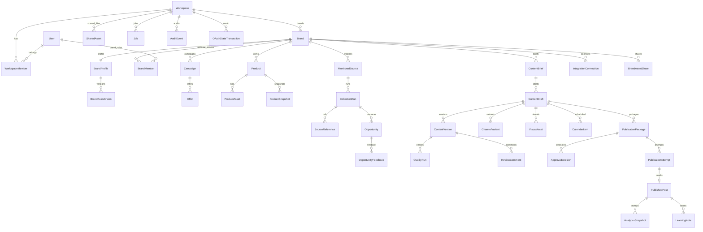

# Data Model — Multi-Brand AI CMO Platform

Prisma-oriented entity design. **MVP** = required for Screens 1–11 initial vertical slices. **Later** = explicit deferral.

**Phase 0.5:** Tenant composite rules, `PublicationPackage`, append-only `ApprovalDecision`, job leases, campaign/offer, structured analytics — see `docs/FINDINGS_REGISTER.md`.  
**Multi-brand (DEC-021):** `Brand` under `Workspace`; brand-specific rows carry `brandId` + composite `(workspaceId, brandId)` integrity.

---

## 1. Conventions

- **Workspace** = org/team boundary (auth, billing, members). **Brand** = marketing scope (catalogue, content, integrations default).
- All **brand-specific** data scoped by `workspaceId` **and** `brandId` (except `User`, Auth.js tables, `Workspace`, `WorkspaceMember`, and optional workspace-only portfolio config)
- Child rows loaded by **API id** or **background workers** **must** store `workspaceId` and `brandId` directly — do not rely on join-only scoping
- **Composite tenant integrity:** for each parent/child pair, enforce child.`workspaceId` = parent.`workspaceId` **and** child.`brandId` = parent.`brandId` (Prisma: `@@index([workspaceId, brandId, parentId])`; migration SQL composite FKs where Prisma cannot express them)
- **Portfolio aggregation** does not use a shared “all brands” table — query per permitted `brandId` and merge in service layer (DEC-022)
- UUID primary keys (`@id @default(uuid())`)
- `createdAt` / `updatedAt` on all models
- Money: `price` / offer amounts as `Decimal` (`@db.Decimal(12, 2)`), never binary float
- Soft delete optional on `Product`, `ContentDraft` — use `archivedAt` when needed
- JSON columns for flexible metadata only when shape is validated at service boundary

### 1.1 Direct `workspaceId` + `brandId` on worker/API-addressable children

| Model | Why |
|-------|-----|
| `ProductAsset`, `ProductSnapshot` | Asset URLs fetched by id in publish/approval |
| `ChannelVariant`, `VisualAsset` | Variant/media changes affect publish package |
| `QualityRun`, `ReviewComment`, `ApprovalDecision` | Queried by version/package id |
| `SourceReference`, `OpportunityFeedback` | Collection provenance |
| `PublicationPackage`, `PublicationAttempt` | Publish worker |
| `AnalyticsSnapshot`, `LearningNote` | Import jobs |
| `OAuthStateTransaction` | Callback without path workspace; includes `brandId` when connection is brand-scoped |

### 1.2 Shared workspace assets (optional explicit share)

Some connections or media libraries may be **shared** across brands in one workspace:

| Model | Purpose |
|-------|---------|
| `SharedAsset` | Workspace-owned file/metadata; not brand-owned by default |
| `BrandAssetShare` | `sharedAssetId`, `brandId`, `permission` (`READ` / `USE_IN_PUBLISH`) |
| `IntegrationConnectionShare` | `connectionId`, `brandId`, `capabilities` subset |

Default: `IntegrationConnection.brandId` set — connection belongs to one brand. Share row grants another brand limited use without duplicating tokens.

---

## 2. Entity relationship overview



---

## 3. MVP entities

### Identity & access

| Model | Key fields | Notes |
|-------|------------|-------|
| `User` | `email`, `name`, `image` | Auth.js adapter compatible |
| `Workspace` | `name`, `slug` | Org/team; may host many brands |
| `WorkspaceMember` | `workspaceId`, `userId`, `role` | Enum `WorkspaceRole` |
| `Session` / `Account` | per Auth.js | If using Auth.js Prisma adapter |

### Brand (DEC-021)

| Model | Key fields | Notes |
|-------|------------|-------|
| `Brand` | `workspaceId`, `slug`, `displayName`, `status` (`ACTIVE`/`ARCHIVED`), `archivedAt?` | Archive retains audit/publish history; blocks new ops |
| `BrandProfile` | `workspaceId`, `brandId`, `websiteUrl`, `voiceSummary`, `pillars` (Json), `locales` | 1:1 with `Brand`; Screen 2 onboarding per brand |
| `BrandRuleVersion` | `workspaceId`, `brandId`, `brandProfileId`, `version`, `allowedClaimIds`, `prohibitedClaims`, `visualGuidelines`, `effectiveAt` | Rules reference claim IDs |
| `BrandMember` | `workspaceId`, `brandId`, `userId`, `role?` | **Optional MVP:** if empty, all workspace members access all non-archived brands |
| `TeamAssignment` | `workspaceId`, `brandId?`, `userId`, `approvalDuty` | Per-brand duty flags when needed |

### Catalogue & commercial context (REQ-BRIEF-012)

| Model | Key fields | Notes |
|-------|------------|-------|
| `Product` | `workspaceId`, `brandId`, `sku`, `name`, `category`, `url`, `material`, `dimensions`, `price` (Decimal), `currency`, `stockStatus`, `stockCheckedAt`, `replenishmentEta?`, `priorityRank?` | `@@unique([brandId, sku])` |
| `ProductAsset` | `workspaceId`, `brandId`, `productId`, `type`, `url`, `alt`, `rightsStatus`, `contentHash?` | Publish package references asset hashes |
| `ApprovedClaim` | `workspaceId`, `brandId`, `productId?`, `brandProfileId`, `text`, `claimId` | Canonical grounding records |
| `ProductSnapshot` | `workspaceId`, `brandId`, `productId`, `payload` (Json), `capturedAt`, `source` | Immutable point-in-time; linked from `PublicationPackage` |
| `Campaign` | `workspaceId`, `brandId`, `name`, `objective`, `startAt`, `endAt`, `status` (`DRAFT`/`ACTIVE`/`ENDED`) | Editorial/commercial planning — not paid ads (REQ-MDI-020) |
| `Offer` | `workspaceId`, `brandId`, `campaignId?`, `name`, `terms`, `discountLabel?`, `startAt`, `endAt`, `status`, `eligibleProductIds` (Json) | Expired offer → publish blocker unless waived (DEC-020) |

**Stock freshness (REQ-MDI-063):** configurable `stockFreshnessHours` per **brand** (or workspace default), default 24. If `now - stockCheckedAt > TTL`, treat stock as **stale** for publish (hard blocker until refresh or explicit waivable policy).

### Research

| Model | Key fields | Notes |
|-------|------------|-------|
| `MonitoredSource` | `workspaceId`, `brandId`, `type`, `identifier`, `connectorId`, `scanFrequency`, `healthStatus` | Screen 5; per-brand watchlist |
| `CollectionRun` | `workspaceId`, `brandId`, `sourceId`, `status`, `startedAt`, `finishedAt`, `itemCount`, `error` | Logs |
| `SourceReference` | `workspaceId`, `brandId`, `runId`, `url`, `title`, `rawExcerpt`, `fetchedAt`, `fetchStatus` | Provenance; URL passed SSRF validator before fetch |
| `Opportunity` | `workspaceId`, `brandId`, `title`, `summary`, `score`, `dedupeKey`, `status`, `productId?` | Feed |
| `OpportunityFeedback` | `workspaceId`, `brandId`, `opportunityId`, `userId`, `action` (`SHORTLIST`/`REJECT`/`REQUEST_ANGLE`), `reason` | Matches API enum |

### Content

| Model | Key fields | Notes |
|-------|------------|-------|
| `ContentBrief` | `workspaceId`, `brandId`, `opportunityId?`, `objective`, `audience`, `cta`, `constraints` | Studio entry |
| `ContentDraft` | `workspaceId`, `brandId`, `briefId`, `parentIdeaId?`, `format`, `workflowStatus`, `currentVersionId?` | Publish guard uses `currentVersionId` |
| `ContentVersion` | `workspaceId`, `brandId`, `draftId`, `version`, `body` (Json), `contentHash`, `createdByUserId` | Immutable; DEC-008 uses `createdByUserId` |
| `ChannelVariant` | `workspaceId`, `brandId`, `draftId`, `platform`, `payload` (Json), `payloadHash` | Changes to CTA/URL/copy affect `PublicationPackage` hash |
| `VisualAsset` | `workspaceId`, `brandId`, `draftId`, `provider`, `url`, `status`, `rightsStatus`, `contentHash` | Generation coordination |
| `CalendarItem` | `workspaceId`, `brandId`, `draftId`, `scheduledAt`, `ownerId`, `productionStatus` | Screen 7 |

### Quality & approval

| Model | Key fields | Notes |
|-------|------------|-------|
| `QualityRun` | `workspaceId`, `brandId`, `contentVersionId`, `publicationPackageId?`, `checkType`, `severity` (`PASS`/`WARN`/`BLOCKER`), `result`, `details` (Json), `waivedAt?`, `waivedByUserId?`, `waiverReason?` | Blockers per REQ-BRIEF-055; waivers audited (DEC-020) |
| `ReviewComment` | `workspaceId`, `brandId`, `contentVersionId`, `userId`, `body`, `resolvedAt` | Thread |
| `ApprovalDecision` | `workspaceId`, `brandId`, `publicationPackageId`, `decision` (`APPROVED`/`REJECTED`/`CHANGES_REQUESTED`), `actorUserId`, `packageHashAtDecision`, `contentVersionId`, `comment?`, `createdAt` | **Append-only** — never update or delete |
| `PublicationPackageApprovalState` | `workspaceId`, `brandId`, `publicationPackageId`, `status`, `latestDecisionId`, `validForPackageHash` | Current approval validity; updated only when new decision applies to current hash |

**Deprecated pattern:** single mutable `Approval` row per version — replaced by decisions + package state (Phase 0.5).

### Publication package (DEC-016)

Immutable **sealed** package = exact publish intent. Material change → new package row (increment `packageVersion` on draft).

| Field group | Stored on `PublicationPackage` |
|-------------|-------------------------------|
| Target | `workspaceId`, `brandId`, `draftId`, `contentVersionId`, `connectionId`, `platform`, `accountExternalId` |
| Copy | `caption`, `slides` (Json), `metadata` (Json) — frozen at seal |
| Media | `mediaAssetRefs` (Json): `{ visualAssetId, contentHash, publicUrl }[]` |
| Destination | `destinationUrl`, `trackingParams` (Json) |
| Commercial | `productSnapshotIds[]`, `offerIds[]`, `campaignId?` |
| Integrity | `packageHash`, `sealedAt`, `supersededAt?`, `supersededByPackageId?` |

Seal operation computes `packageHash` = SHA-256 canonical JSON of publish-relevant fields. Approval binds to `packageHashAtDecision`.

### Integrations & publish

| Model | Key fields | Notes |
|-------|------------|-------|
| `IntegrationConnection` | `workspaceId`, `brandId`, `platform`, `accountLabel`, `accountExternalId`, `capabilities` (Json), `encryptedCredentials`, `credentialKeyVersion`, `health`, `lastSyncAt`, `tokenExpiresAt?` | Per-brand default; share via `IntegrationConnectionShare` |
| `OAuthStateTransaction` | `workspaceId`, `brandId`, `userId`, `platform`, `nonce`, `expiresAt`, `consumedAt?` | Single-use state (DEC-017) |
| `PublicationAttempt` | `workspaceId`, `brandId`, `publicationPackageId`, `connectionId`, `idempotencyKey`, `status`, `externalId?`, `reconciliationStatus?`, `error?` | Ambiguous timeout → `reconciliationStatus=PENDING_VERIFY` before retry |
| `PublishedPost` | `workspaceId`, `brandId`, `attemptId`, `platform`, `permalink`, `publishedAt` | Manual or API |

### Analytics & learning

| Model | Key fields | Notes |
|-------|------------|-------|
| `AnalyticsSnapshot` | `workspaceId`, `brandId`, `publishedPostId`, `periodStart`, `periodEnd`, `metrics` (Json), `source`, `importIdempotencyKey`, `collectedAt` | Metrics: see § Analytics metric shape |
| `LearningNote` | `workspaceId`, `brandId`, `publishedPostId?`, `opportunityId?`, `body`, `experimentTag` | Traceable |
| `UtmMapping` | `publishedPostId`, `campaign`, `parameters` (Json) | Optional MVP |

### System

| Model | Key fields | Notes |
|-------|------------|-------|
| `AuditEvent` | `workspaceId`, `brandId?`, `actorUserId`, `action`, `entityType`, `entityId`, `metadata` (Json) | `brandId` optional for workspace-level events |
| `AiWorkflowRun` | `workspaceId`, `brandId`, `workflowId`, `promptVersion`, `inputHash`, `status`, `tokenUsage`, `scope` (`brand`/`portfolio`) | Portfolio runs log `scope=portfolio` without mixing prompts |
| `Job` | `workspaceId`, `brandId?`, `type`, `payload`, `status`, `runAt`, `attempts`, `maxAttempts`, `leasedBy`, `leasedUntil`, `nextRunAt`, `deadLetterAt`, `externalIdempotencyKey?` | Brand-scoped jobs require `brandId`; workspace jobs (e.g. retention) may omit |

---

## 4. Later entities (not MVP)

| Model | When |
|-------|------|
| `AdCampaign`, `AdCreative` | Paid ads phase |
| `DmThread`, `AutoReplyRule` | Out of scope |
| `InfluencerCampaign` | Not in charter |
| `WebhookSubscription` | Enterprise integrations |
| `FeatureFlag` | Multi-tenant rollout |

---

## 5. Prisma sketch (illustrative excerpt)

Not applied until scaffold — names and relations for implementers:

```prisma
enum WorkspaceRole {
  OWNER
  ADMIN
  EDITOR
  REVIEWER
  VIEWER
}

enum ApprovalDecisionType {
  APPROVED
  REJECTED
  CHANGES_REQUESTED
}
// Current validity: PublicationPackageApprovalState.status (derived from latest decision on current packageHash)

// REQ-BRIEF-063 — content production workflow (distinct from ApprovalStatus)
enum ContentWorkflowStatus {
  SUGGESTED
  SHORTLISTED
  BRIEF_READY
  IN_PRODUCTION
  DRAFT_REVIEW
  AWAITING_APPROVAL
  APPROVED
  SCHEDULED
  PUBLISHED
  REVIEWED
  REJECTED
  BLOCKED
  CANCELLED
}

model Workspace {
  id        String   @id @default(uuid())
  name      String
  slug      String   @unique
  members   WorkspaceMember[]
  brands    Brand[]
  createdAt DateTime @default(now())
  updatedAt DateTime @updatedAt
}

model Brand {
  id          String   @id @default(uuid())
  workspaceId String
  slug        String
  displayName String
  status      BrandStatus @default(ACTIVE)
  profile     BrandProfile?
  @@unique([workspaceId, slug])
}

model ContentDraft {
  id                String   @id @default(uuid())
  workspaceId       String
  brandId           String
  briefId           String
  currentVersionId  String?
  workflowStatus    ContentWorkflowStatus
}

model ContentVersion {
  id              String   @id @default(uuid())
  workspaceId     String
  draftId         String
  version         Int
  body            Json
  contentHash     String
  createdByUserId String
  qualityRuns     QualityRun[]
  @@unique([draftId, version])
}

model PublicationPackage {
  id                String   @id @default(uuid())
  workspaceId       String
  brandId           String
  draftId           String
  contentVersionId  String
  connectionId      String
  packageHash       String
  sealedAt          DateTime
  @@index([workspaceId, brandId, draftId])
}
```

Full schema to be generated during Screen 1–2 scaffold with incremental migrations per screen.

---

## 6. Analytics metric shape (JSON validated at boundary)

Each metric key maps to:

```typescript
type MetricValue = {
  status: "available" | "unavailable" | "delayed";
  value?: number;           // present only when status === "available"
  unit?: string;            // e.g. "count", "percent", "seconds"
  nativeName?: string;      // platform field name
  normalizedName?: string;  // for cross-channel compare when valid
  observedAt?: string;      // ISO datetime
};
```

**Rules:** missing platform field → `unavailable` (UI must not show `0`). GA4 sessions ≠ Meta clicks — comparisons only where `normalizedName` explicitly aligned (REQ-BRIEF-089). `LearningNote` must cite `publishedPostId` + sample size when inferring patterns.

---

## 7. Indexing (MVP)

- `Opportunity(workspaceId, brandId, status, score DESC)`
- `CalendarItem(workspaceId, brandId, scheduledAt)`
- `PublicationAttempt(workspaceId, brandId, idempotencyKey)` unique
- `AnalyticsSnapshot(workspaceId, brandId, importIdempotencyKey)` unique
- `Brand(workspaceId, status)`
- `Job(status, runAt)` partial where `PENDING`
- `Job(leasedUntil)` where `RUNNING`
- `OAuthStateTransaction(nonce)` unique
- `AuditEvent(workspaceId, createdAt)`
- `Product(workspaceId, brandId, sku)` unique

---

## 8. Data retention

- Raw external excerpts: configurable TTL (default 90 days) — **DEC-007**; enforced by scheduled `Job` type `RETENTION_CLEANUP` (deletes `SourceReference.rawExcerpt` or archives row)
- Analytics snapshots: retain indefinitely; aggregate older than 24 months — later

## 9. Phase 0 additions (2026-11-20)

Built in Prisma (`prisma/schema.prisma`); section 5 is only a sketch.

- `ContentItem.ownerId String?` to `User` (relation `ContentOwner`, `onDelete: SetNull`), index `(brandId, ownerId)`. Set
  from the creator or the run's starter; null = unassigned. Migration `content_owner` backfills it.
- Migration `approval_brand_index` adds an approval index by brand for the reviewer and `hasOtherApprover` lookups.
- The create `requestId` is kept in the item's `brief` JSON (`brief.requestId`), not a column; a retried create finds the
  first item through `itemForRequest` under an advisory lock.
- A post body (`ContentVersion.body`) may hold `pinLink` (Pinterest destination, max 2000 chars).
- Roles: system `client-reviewer` (PROJECT scope) added to every workspace by migration `client_reviewer`, which also adds
  `inbox.read`, `content.download` and (custom roles holding `content.create` or `agents.run`, never the custom role renamed
  from the slug `client-reviewer`) `agents.read` by guarded `array_append`.
- `ApprovalDecision.byClient Boolean @default(false)` (migration `20261120070845_approval_by_client`): set at decision time
  when the decider is a client reviewer, never looked up later. It drives "a client approval never auto-publishes" and
  the client send-back rule (a client may reopen only an approval with `byClient` and their own `userId`). Index
  `(brandId, verdict, createdAt)` came with `approval_brand_index`.

## 10. Phase 0 follow-up additions (2026-11-20)

- Index `ContentItem(brandId, updatedAt)` (migration `20261120082134_content_updated_index`) for the calendar's recent
  half (`orderBy updatedAt desc`). Checked with EXPLAIN on 20,000 scratch rows; the dev table is too small to use it.
- No column changes. A story's `ContentVersion.body.frames[].rights` still holds `{ kind, by, name }` for confirmed rights;
  old bodies may hold an email as `name`. They are not rewritten: reads hide rights for callers who can't see names, and
  `scripts/redact-story-checks.ts` (temporary, per environment) rewrites only the passing "Asset rights" note in
  `QualityCheck.results`.

## 11. Shop orders, order lines and product extras (2026-11-25)

Migration `20261125150000_shop_order_lines`. No customer data anywhere: AskCart never sends any.

- `ShopOrder` (one Shopify order's totals, upserted on `(brandId, shopifyId)`; an older read never overwrites a newer
  one) gains the following columns. They are AskCart only; the pasted-token path writes their defaults when it inserts an
  order and keeps the stored values when it updates one.
  - `fulfillmentStatus String?` and `financialStatus String?` (Shopify's display enums).
  - `discountCodes String[]`: codes only. They can be personal, so the chat shows only codes used on 2 or more orders.
  - `lineItemsTruncated Boolean`: more than 100 lines, or AskCart paused mid-order. The sync re-reads the second kind
    for a day.
  - A field left out of a read keeps its stored value; a status sent as null clears it.
- `ShopOrderLine`: one row per line item, keyed `(brandId, lineShopifyId)`, indexed `(brandId, orderShopifyId)`, linked
  to its order by `orderShopifyId`.
  - Columns: `productId`, `variantId` (null when deleted), `title` / `variantTitle` (null for lines without a product),
    `sku`, `quantity` (as ordered), `currentQuantity` (net of refunds), `unitPrice`, `discountedTotal` (includes
    refunded units), `netUnitPrice` (after every discount), `currency`.
  - Net line sales = `currentQuantity × netUnitPrice`, with `quantity` when there is no `currentQuantity` and
    `discountedTotal ÷ quantity` when there is no `netUnitPrice`. A line with neither a `netUnitPrice` nor a quantity to
    divide by counts 0.
  - Written only when the order's row is written, and upserted. An order read without line items keeps its lines; lines
    gone from the order are deleted only when the order was sent whole (not flagged `lineItemsTruncated`, no line we
    couldn't read).
- `Product` gains `vendor String?`, `tags String[]` (sorted) and `collections Json?` (`[{ id, title, handle }]`, sorted
  by id). They are AskCart products only; the other sources never touch them. The chat matches a line to its
  catalogue row by `Product.externalId = ShopOrderLine.variantId` (source SHOPIFY).

## 12. Money layer (2026-11-26)

Five migrations, all additive (new tables, nullable columns, one enum value), no table rewrite:
`20261126100000_fx_rate`, `20261126110000_shop_order_shipping_taxes`, `20261126120000_ad_platform_google`,
`20261126120100_ad_budget`, `20261126130000_post_metric_navigation`.

- `FxRate`: the ECB's daily euro reference rate, `(currency, day)` primary key, `perEur Decimal(18,6)` (units of
  `currency` per euro). Filled once a day by the `fx.sync` job (server/data/fx.ts) for the currencies in use (ECB
  currencies only); a weekend or TARGET holiday has no row, so a reader takes the latest rate on or before the day it
  needs (rateTable). Used to compare ad spend and sales held in different currencies; nothing is stored converted.
- `ShopOrder.shippingTaxes Decimal(14,2)?`: the tax on the shipping still charged (shippingTaxesOf), so net sales
  without VAT can take it out. Null on rows read before the migration and when the shipping lines came unreadable;
  such tax-included orders count as "VAT couldn't be read" (`exVatMissing`) from `SHIPPING_TAXES_SINCE` on, until
  `reset:shopify-orders` re-reads them.
- `AdPlatform.GOOGLE`: added in its own migration, since Postgres can't use an enum value added by `ALTER TYPE … ADD
  VALUE` in the same transaction. No Google Ads sync exists yet; the value lets a budget be set for it.
- `AdBudget`: a brand's monthly budget per platform, unique on `(brandId, platform, month)`; `month` is the first day
  of the month, `amount Decimal(14,2)` in `currency` (EUR or one of ECB_CURRENCIES), `updatedByUserId`. Cascades with
  the brand. Meta pacing compares it with the month's spend (server/data/budgets.ts).
- `PostMetric.navigation Int?`: Instagram stories only, taps forward, back, exits and next-story swipes summed over the
  frames; null for every other post.
- The Meta Ads system user token has no column of its own: it is an ACTIVE `IntegrationConnection` (provider
  META_ADS) with `tokenExpiresAt` null. A personal login always has an expiry, and saveConnections' `keep` rule never
  lets it replace a working system token.

## 13. Ads alerts (2026-11-26)

Two migrations, both additive: `20261126140000_notification_ad_alert_kind`, `20261126140100_ad_alert`.

- `NotificationKind.AD_ALERT`: added in its own migration, since Postgres can't use an enum value added by `ALTER
  TYPE … ADD VALUE` in the same transaction. An `AD_ALERT` notice has no task and no actor; `Notification.adAlertId`
  (nullable, cascades with the alert, indexed) points at its alert, and its dedupeKey is `AD_ALERT:<userId>:<alertId>`.
  Who gets one: active people holding brand.read and ads.read on the brand (role ∪ grant); who still sees it: the same
  keys at read time, brand not archived (visibleNotificationsSql).
- `AdAlert`: one row per alert episode on a brand. `kind` (`AdAlertKind`: SPEND_UP, ROAS_DOWN, NO_PURCHASES,
  OVER_PACE), `accountId` ("act_…", null for the brand-wide OVER_PACE), `campaignId` and `campaignName` (NO_PURCHASES),
  `currency`, `firstDay`/`lastDay` (`@db.Date`, the rule's own day), `values Json` (the figures as strings),
  `subjectKey` (`<kind>:<brandId>:<account>[:<campaign>]` or `OVER_PACE:<brandId>:<YYYY-MM>`) and a unique `dedupeKey`
  (subjectKey + first day; OVER_PACE: subjectKey, once a month). A day within one day of an episode moves its
  `lastDay` on instead of making a new row. Indexes `(brandId, subjectKey, lastDay)`, `(brandId, lastDay)` (the chat's
  recent alerts) and `(brandId, createdAt)` (the digest's week). Cascades with the brand. Written by the `ads.alerts`
  job (server/ads/alerts.ts).

## 14. Task files (2026-11-27, branch `tasks-calendar`)

`TaskFile` (migration `20261127110000_task_files`): a document on a task, kept apart from `MediaUpload` so it never
reaches the story picker or the photo library. Direct `workspaceId` + `brandId` (§1.1), `taskId` (cascade), `key`
(unique; `<ws>/<brand>/task-files/uploads/<uuid>.<ext>` while PENDING/CHECKING, `<ws>/<brand>/task-files/<uuid>.<ext>`
once VERIFIED), `status` (PENDING | CHECKING | VERIFIED; a refused file loses its row), `contentType` (the verified one,
shared `TASK_FILE_TYPES`), `fileName` (display only), `bytes`, `createdById`, `createdAt`. Indexes (taskId, status),
(status, createdAt). Routes: POST `tasks/:id/files`, POST and DELETE `tasks/:id/files/:fileId` (server/tasks/files.ts).
